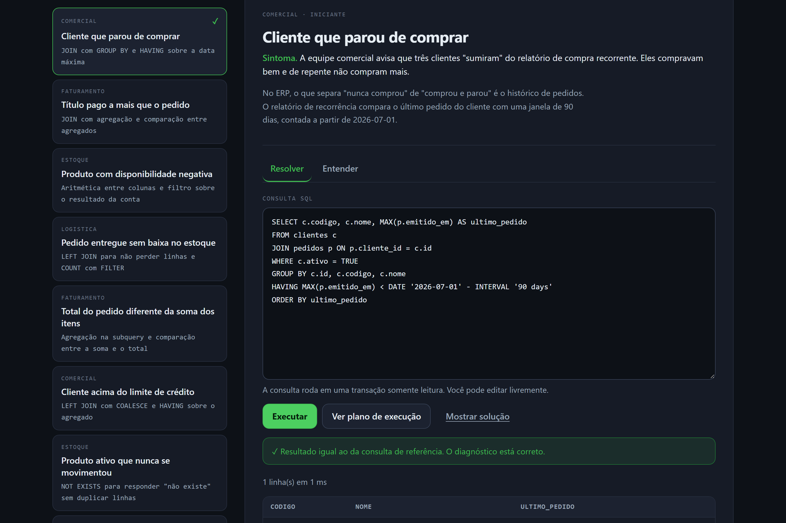
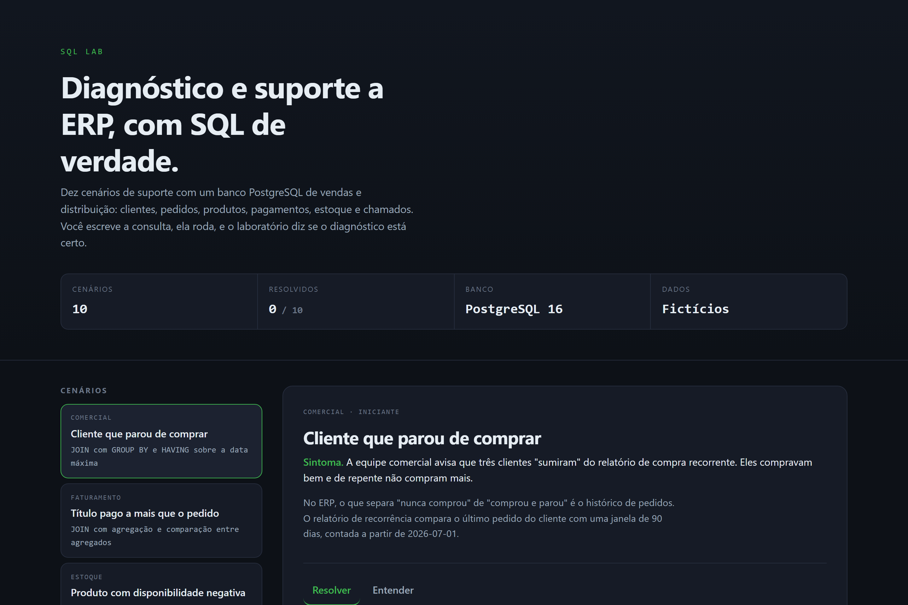
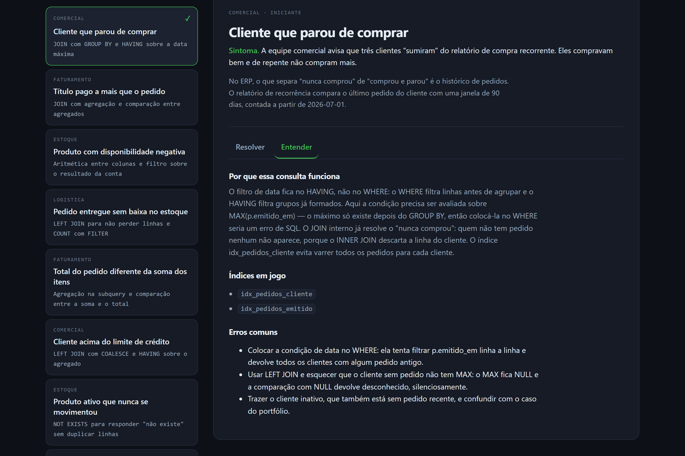
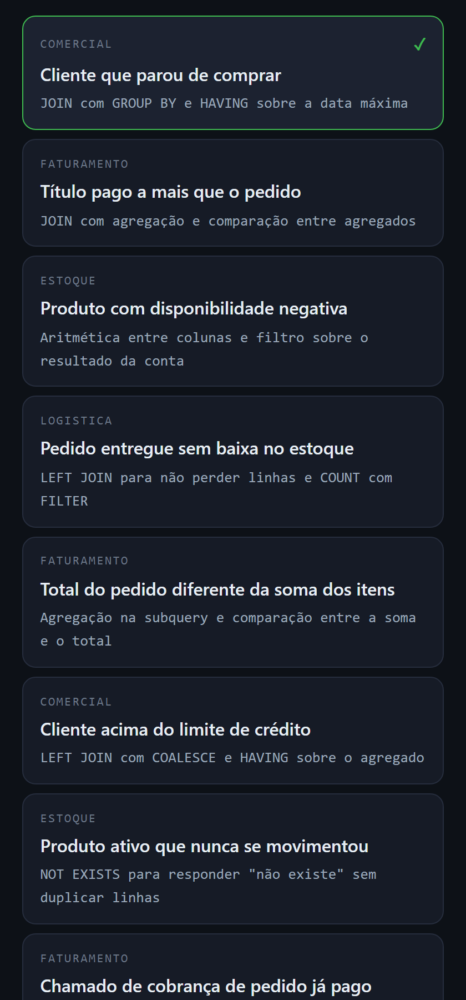

# SQL Lab

**Laboratório de SQL para diagnóstico e suporte a sistemas ERP.**

Dez cenários de suporte com um banco PostgreSQL de vendas e distribuição:
clientes, pedidos, produtos, pagamentos, estoque e chamados. Cada cenário
apresenta um sintoma relatado por quem opera o ERP, e o aluno escreve a consulta
SQL que resolve o problema. A consulta **roda de verdade** no banco, e o
laboratório compara o resultado com a consulta de referência.



## O problema que o projeto resolve

No suporte a ERP, a maior parte do tempo vira a mesma coisa: abrir scripts,
montar filtros e conferir inconsistências. Um iniciante não tem onde praticar, e
um ERP real não pode servir de campo de treinamento.

O SQL Lab é o lugar de prática: um banco sintético com o vocabulário de um ERP
de verdade, onde cada consulta executada é conferida e explicada.

## Os dez cenários do MVP

| #   | Cenário                                     | Técnica                                 |
| --- | ------------------------------------------- | --------------------------------------- |
| 1   | Cliente que parou de comprar                | `GROUP BY` com `HAVING` sobre `MAX()`   |
| 2   | Título pago a mais que o pedido             | agregação e comparação entre agregados  |
| 3   | Produto com disponibilidade negativa        | aritmética entre colunas da mesma linha |
| 4   | Pedido entregue sem baixa no estoque        | `LEFT JOIN` com `COUNT` e `FILTER`      |
| 5   | Total do pedido diferente da soma dos itens | subquery agregada e `HAVING`            |
| 6   | Cliente acima do limite de crédito          | `LEFT JOIN` com `COALESCE` e `FILTER`   |
| 7   | Produto ativo que nunca se movimentou       | `NOT EXISTS`                            |
| 8   | Chamado de cobrança de pedido já pago       | `EXISTS` com agregação aninhada         |
| 9   | Título vencido que ninguém cobrou           | filtro de intervalo de datas            |
| 10  | Quem concentra o faturamento                | soma acumulada com `SUM() OVER`         |

A lista completa, com o sintoma, a explicação e os erros comuns de cada um,
está em `apps/api/src/scenarios/index.ts` — e na aba **Entender** da interface.

## Como funciona

1. O aluno escolhe um cenário e lê o sintoma.
2. Escreve a consulta no editor — o esqueleto inicial é uma dica, não uma
   resposta.
3. **Executar** roda a consulta no PostgreSQL e devolve a tabela de resultado.
4. O laboratório compara o resultado com a consulta de referência e diz se o
   diagnóstico está certo. A comparação ignora a ordem das linhas e normaliza
   números: `110.50` e `'110.50'` são o mesmo valor.
5. **Ver plano de execução** mostra o `EXPLAIN`, para o aluno ver qual índice
   foi usado.
6. **Entender** traz a explicação didática, os índices em jogo e os erros
   comuns. **Mostrar solução** revela a consulta de referência.

Dicas são reveladas uma a uma, para quem trava.

<details>
<summary>Mais telas</summary>

**A lista de cenários, com a área e a técnica de cada um:**



**A aba "Entender", com a explicação, os índices em jogo e os erros comuns:**



**A interface em tela estreita:**



</details>

## Instalação

### Requisitos

- Node.js 20 ou superior
- PostgreSQL 16 (local, Docker ou o gratuito do Neon)

### Com Docker

```bash
docker compose up -d postgres
```

### Sem Docker

Um PostgreSQL 16 local, com dois bancos: um de desenvolvimento e um de teste.

```bash
createdb sql_lab
createdb sql_lab_test
```

### Configuração

```bash
cp .env.example .env
```

Edite o `.env` com a connection string. No PostgreSQL local, o usuário
`sql_lab` precisa existir:

```sql
CREATE ROLE sql_lab LOGIN PASSWORD 'sql_lab';
GRANT ALL PRIVILEGES ON DATABASE sql_lab TO sql_lab;
GRANT ALL PRIVILEGES ON DATABASE sql_lab_test TO sql_lab;
```

### Preparar o banco

```bash
npm install
npm run db:reset
```

O comando recria o esquema e a carga fictícia. A saída mostra quantos registros
foram criados em cada tabela.

### Rodar

```bash
npm run dev
```

- Interface: <http://localhost:5173>
- API: <http://localhost:3000>

## Testes

```bash
npm test
```

**45 testes** em três suítes, contra um PostgreSQL de verdade:

| Suíte             | Testes | O que cobre                                        |
| ----------------- | ------ | -------------------------------------------------- |
| `packages/shared` | 3      | contrato das listas compartilhadas                 |
| `apps/api`        | 32     | carga fictícia, os 10 cenários e a execução segura |
| `apps/web`        | 10     | cliente da API e a sessão anônima                  |

A suíte da API recria o banco de teste do zero antes de rodar, para que o
resultado de referência seja estável.

O que os testes de segurança garantem:

- `UPDATE`, `DELETE`, `DROP` e `INSERT` são **recusados pelo servidor**;
- os dados continuam intactos depois de uma tentativa de escrita;
- erro de sintaxe e tabela inexistente voltam com a mensagem do PostgreSQL.

A proteção não depende de a API confiar no texto da consulta: vem de uma
transação `READ ONLY` com tempo limite.

```bash
npm run validate   # formatação, lint, tipos, build e as três suítes
```

## Arquitetura

```
sql-lab/
├── apps/
│   ├── api/          API Express + TypeScript
│   │   ├── src/
│   │   │   ├── config/env.ts          leitura do .env
│   │   │   ├── database/pool.ts       conexão e transação READ ONLY
│   │   │   ├── database/setup.ts      aplicação do schema e da carga
│   │   │   ├── scenarios/             os dez cenários
│   │   │   ├── services/              execução de SQL, comparação, progresso
│   │   │   └── routes/                a API REST
│   │   └── src/tests/                 suítes de integração
│   └── web/          interface React + Vite
├── packages/shared/  tipos compartilhados entre a API e a interface
├── db/
│   ├── schema.sql    esquema do ERP, com constraints e índices
│   └── seed.sql      carga fictícia determinística
└── docs/             instalação, arquitetura e decisões
```

### Decisões que valem explicar

**A consulta do aluno roda em uma transação `READ ONLY`.** A proteção contra
escrita é do servidor, não da aplicação. É o que permite aceitar SQL escrito
por terceiros sem risco para o banco.

**A verificação compara resultados, não textos.** Qualquer consulta que
responda à mesma pergunta conta como resolvida — mesmo com outra sintaxe, outra
ordem de colunas ou `NUMERIC` como texto.

**O progresso é anônimo.** Uma sessão é um identificador aleatório de 16 bytes,
gerado no navegador. O laboratório não pede nome, e-mail nem documento, e o
identificador não é derivado de nada que identifique a pessoa.

**A carga é SQL puro.** `db/seed.sql` é um arquivo de texto executado pelo
PostgreSQL. Isso torna a carga determinística, revisável e utilizável como
material de estudo.

## Tecnologias

| Camada    | Tecnologia                                                           |
| --------- | -------------------------------------------------------------------- |
| Banco     | PostgreSQL 16 (migrations em SQL, índices, `EXPLAIN`)                |
| API       | Node.js, Express 5, TypeScript, `pg`                                 |
| Interface | React 19, Vite 7, TypeScript                                         |
| Testes    | Vitest, Supertest-free (chamadas HTTP diretas), `node:test` na carga |
| Qualidade | ESLint, Prettier, TypeScript estrito, CI no GitHub Actions           |

## O banco

O modelo é o de um ERP de vendas e distribuição:

```
clientes ──┬── pedidos ──┬── itens_pedido ── produtos
           │              └── pagamentos
           ├── estoque ── produtos, depositos
           │   └── movimentacoes_estoque
           └── chamados ── pedidos
```

Cada tabela tem as constraints que um ERP de verdade teria: `CHECK` de status,
`UNIQUE` de código, `NOT NULL` e chaves estrangeiras. As consultas aprendidas
aqui têm sentido no banco real porque a forma dos dados é a mesma.

Os índices não são decoração: cada cenário aponta para o índice que a sua
consulta usa, e a aba **Entender** mostra qual deles entra em cena.

## Dados fictícios

Todos os dados são inventados:

- e-mails no domínio `exemplo.invalid`, reservado pela RFC 2606;
- documentos na sequência `000.000.000-01` a `000.000.000-06`, o placeholder
  que o próprio CPF reserva para "não aplicável";
- nomes, cidades e telefones de empresas que não existem.

Nenhum dado de pessoa real é usado, e um teste automatizado verifica isso a
cada execução.

## Limites conhecidos

- Os dez cenários cobrem diagnóstico comercial, financeiro e de estoque. A
  próxima leva o mesmo desenho para **previsão de demanda** e **análise de
  margem por canal**.
- A verificação compara o conjunto de linhas devolvidas, não a consulta. Duas
  consultas com o mesmo resultado contam como a mesma solução — o que é o
  objetivo, mas significa que o laboratório não avalia estilo.
- O plano de execução é exibido em texto, sem estimativa de custo.
- A carga é fixa. Não há gerador de dados aleatórios: o resultado de cada
  cenário precisa ser estável para os testes.

## Autor

[Lucas Santana da Paz](https://github.com/Japapaz696) ·
[LinkedIn](https://www.linkedin.com/in/lucas-santana-da-paz-215816247/)

## Licença

[MIT](LICENSE)
